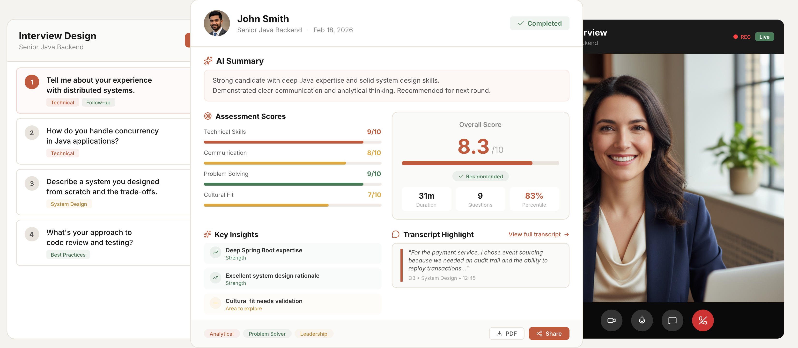
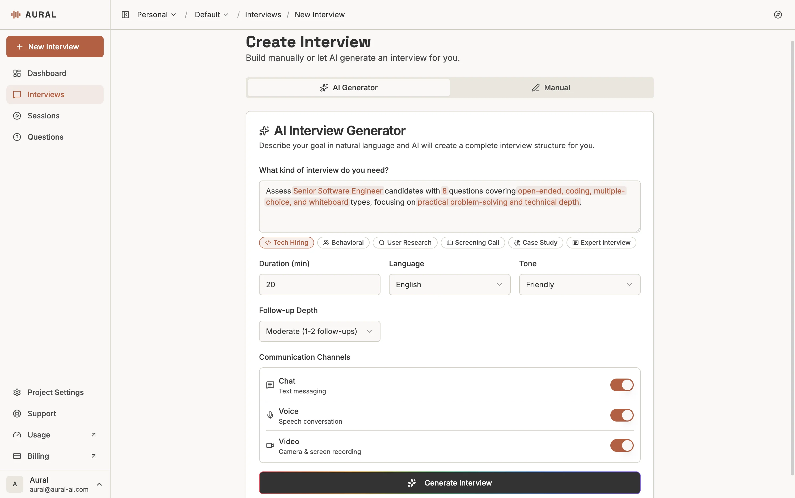
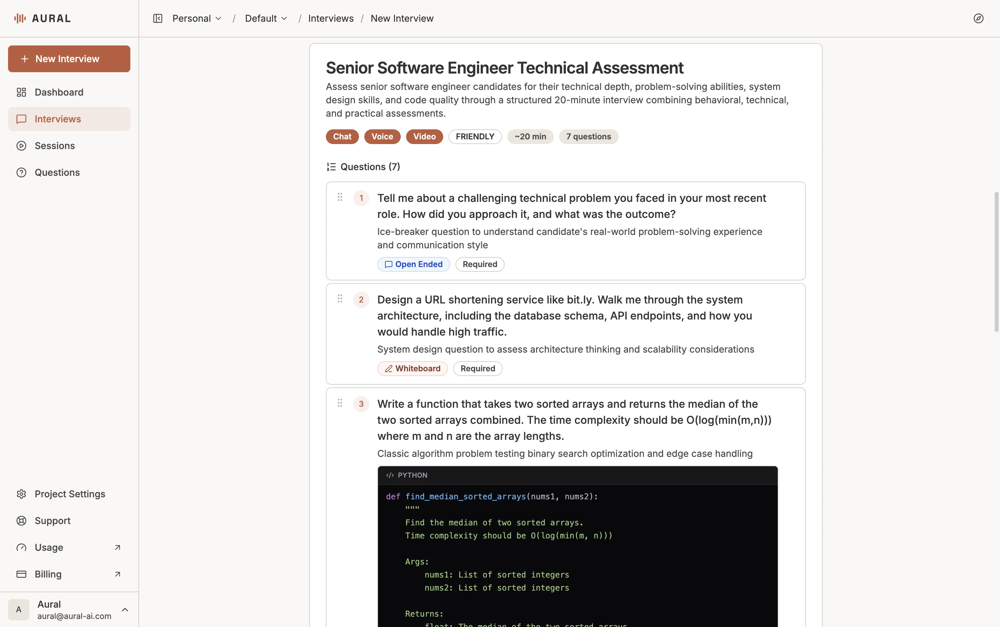
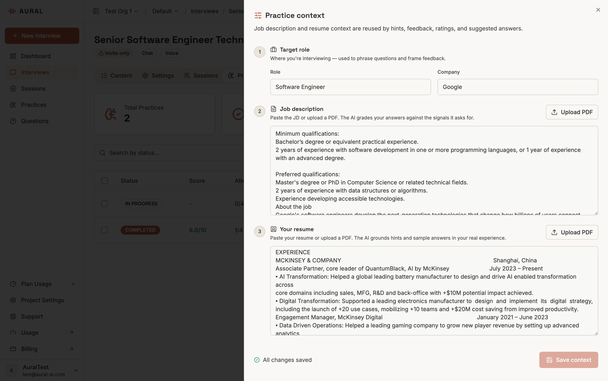
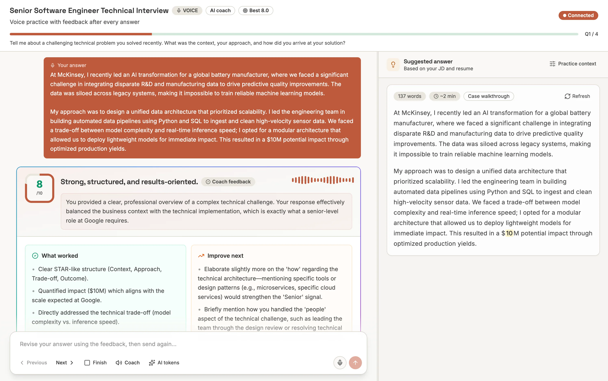
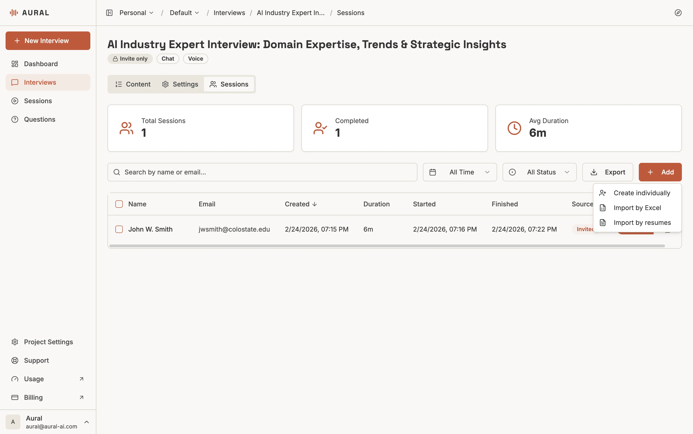
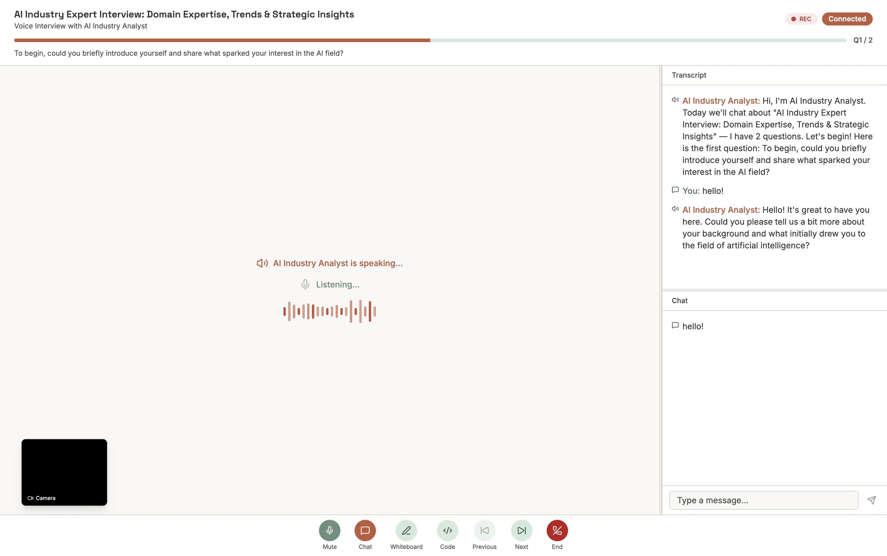
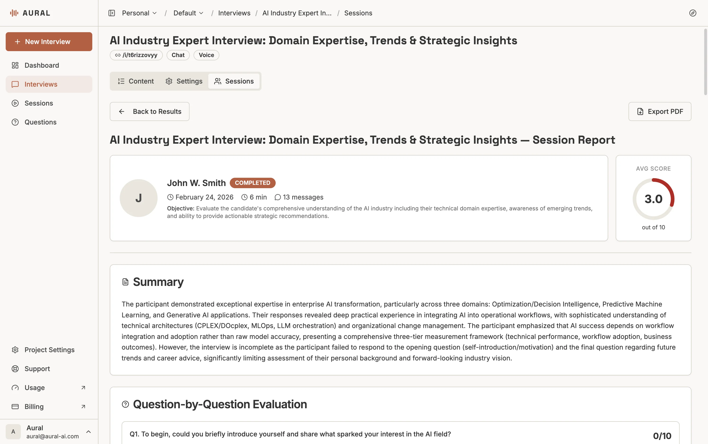

<p align="center">
  <a href="README.md">English</a> &nbsp;·&nbsp;
  <strong>简体中文</strong>
</p>

<p align="center">
  <a href="https://aural-ai.com">
    
  </a>
</p>

<h1 align="center">Aural</h1>

<p align="center">
  <strong>深度对话，自动洞察。</strong><br/>
  面向语音、文字与视频场景的开源 AI 访谈平台。
</p>

<p align="center">
  <a href="https://aural-ai.com">官方网站</a> &nbsp;·&nbsp;
  <a href="https://youtu.be/Mmn1tjTzuwQ">产品视频</a> &nbsp;·&nbsp;
  <a href="https://aural-ai.com/docs">文档</a> &nbsp;·&nbsp;
  <a href="#部署">部署</a>
</p>

<p align="center">
  <a href="https://github.com/1146345502/aural-oss/actions/workflows/ci.yml"></a>
  <a href="https://github.com/1146345502/aural-oss/releases/latest"></a>
  <a href="LICENSE"></a>
  
  
  
  
</p>

<br/>

<p align="center">
  <a href="https://aural-ai.com">
    
  </a>
</p>

<p align="center">
  用自然语言描述访谈目标，分享一个链接，Aural 的 AI 即可完成访谈：<br/>
  自动提问、智能追问，并在访谈结束后生成详细分析。
</p>

<p align="center">
  <b><a href="https://aural-ai.com">体验云服务 &rarr;</a></b>
  &nbsp;&nbsp;&nbsp;
  <b><a href="#自托管">自托管指南 &darr;</a></b>
</p>

---

## 核心能力

<table>
  <tr>
    <td width="25%" align="center"><strong>🎙 语音、文字与视频</strong><br/><sub>支持多种访谈渠道，并根据回答实时调整对话</sub></td>
    <td width="25%" align="center"><strong>🧠 AI 生成访谈</strong><br/><sub>描述目标即可生成完整问题、评估标准与推荐设置</sub></td>
    <td width="25%" align="center"><strong>💻 在线编程</strong><br/><sub>通过 Monaco 编辑器和 Excalidraw 白板完成技术评估</sub></td>
    <td width="25%" align="center"><strong>📊 自动分析报告</strong><br/><sub>生成逐题评分、亮点、改进方向和总结</sub></td>
  </tr>
  <tr>
    <td width="25%" align="center"><strong>🛡 防作弊</strong><br/><sub>页面切换、外部粘贴、多屏检测与完整性日志</sub></td>
    <td width="25%" align="center"><strong>👥 团队管理</strong><br/><sub>组织、项目和基于角色的访问控制</sub></td>
    <td width="25%" align="center"><strong>🌐 多语言</strong><br/><sub>内置中英文和可扩展的本地化系统</sub></td>
    <td width="25%" align="center"><strong>🔌 可插拔大模型</strong><br/><sub>支持 OpenAI、Gemini、Kimi、MiniMax 及兼容接口</sub></td>
  </tr>
  <tr>
    <td width="25%" align="center"><strong>🚀 快速模板</strong><br/><sub>技术、行为、研究等多类预置访谈模板</sub></td>
    <td width="25%" align="center"><strong>🗣 模拟面试</strong><br/><sub>语音练习、实时反馈、参考答案和评分追踪</sub></td>
    <td width="25%" align="center"><strong>🔗 分享与预览</strong><br/><sub>分享访谈链接，上线前以候选人视角预览</sub></td>
    <td width="25%" align="center"><strong>🔑 开发者 API</strong><br/><sub>提供 OpenAPI 规范和完整 REST API</sub></td>
  </tr>
</table>

---

## 产品演示

<p align="center">
  <a href="https://youtu.be/Mmn1tjTzuwQ">
    
  </a>
  <br/>
  <sub>点击观看三分钟产品演示</sub>
</p>

<details>
<summary><strong>中文产品介绍</strong></summary>
<br/>
<p align="center">
  <a href="https://youtu.be/iPZL9aWXp-Q">
    
  </a>
</p>
</details>

---

## 产品概览

Aural 是一个可自主执行结构化访谈的 AI 平台。创建访谈并分享链接后，AI 会负责提问、追问和对话控制，并在会话结束后生成结构化分析。

### 创建访谈

用自然语言描述目标，AI 会生成问题、评估标准和推荐设置；你也可以通过编辑器手动构建访谈。

<p align="center">
  
</p>

支持开放题、单选题、多选题、Monaco 在线编程题和 Excalidraw 白板题。

<p align="center">
  
</p>

### 配置与分享

可设置 AI 人设、语气、追问深度、语言和沟通方式，并通过公开链接或仅限邀请模式控制访问。

<p align="center">
  
</p>

### 模拟面试

将任意访谈转换为模拟面试工作区。添加职位和简历上下文，通过文字或语音练习，获取流式 AI 反馈、追问辅导、参考答案与历史评分，并把优秀答案收藏到答案库。

<p align="center">
  
</p>

<p align="center">
  
</p>

### 邀请候选人

支持手动添加候选人、通过 Excel 批量导入，以及上传 PDF 简历后由 AI 提取候选人信息。每位候选人会获得唯一邀请链接。

<p align="center">
  
</p>

### 执行访谈

候选人可通过文字、语音或视频完成访谈。AI 会根据回答实时调整追问深度、语气和方向，并支持在线编程与白板。

<p align="center">
  
</p>

### 防作弊与结果分析

防作弊模式可以要求摄像头、麦克风和屏幕共享，并记录页面离开、外部粘贴和多屏等事件。访谈完成后，系统生成逐题评分、优势、改进建议和整体总结。

<p align="center">
  
</p>

### 常见使用场景

- **技术招聘**：使用在线编辑器和白板完成编程与系统设计面试
- **用户研究**：通过 AI 追问挖掘更深层的需求和洞察
- **行为面试**：规模化执行自然的语音访谈
- **面试练习**：在正式面试前获得即时 AI 反馈

---

## 技术栈

| 层级 | 技术 |
|------|------|
| 框架 | [Next.js 14](https://nextjs.org/)（App Router） |
| 语言 | TypeScript |
| 数据库 | [Supabase](https://supabase.com/)（PostgreSQL、Auth、Storage、RLS） |
| API | [tRPC](https://trpc.io/) |
| AI / LLM | OpenAI、Google Gemini、Moonshot Kimi、MiniMax，可插拔提供商系统 |
| 语音 | WebSocket 中继服务（火山引擎豆包、Azure OpenAI Realtime） |
| UI | [Tailwind CSS](https://tailwindcss.com/) + [shadcn/ui](https://ui.shadcn.com/) + [Radix](https://radix-ui.com/) |
| 代码编辑器 | [Monaco Editor](https://microsoft.github.io/monaco-editor/) |
| 白板 | [Excalidraw](https://excalidraw.com/) |
| 图表 | [Recharts](https://recharts.org/) |

---

## 架构

```text
┌──────────────────────────────────────────────────────────────┐
│                          浏览器                              │
│  ┌───────────┐  ┌──────────────┐  ┌────────────────────────┐ │
│  │ 管理面板  │  │ 访谈编辑器   │  │ 会话界面               │ │
│  │           │  │              │  │（文字 / 语音 / 视频）  │ │
│  └─────┬─────┘  └──────┬───────┘  └──────────┬─────────────┘ │
│        └───────────┬───┘         ┌───────────┘               │
│                    │             │ WebSocket                 │
└────────────────────┼─────────────┼───────────────────────────┘
                     │ tRPC / REST │
                     ▼             ▼
┌────────────────────────┐  ┌──────────────────┐
│    Next.js 服务端      │  │  语音中继服务   │
│  ┌──────────────────┐  │  │  ┌────────────┐  │
│  │ tRPC 路由        │  │  │  │ 火山引擎   │  │
│  ├──────────────────┤  │  │  │ 豆包 S2S   │  │
│  │ REST API 路由    │  │  │  ├────────────┤  │
│  ├──────────────────┤  │  │  │ Azure OAI  │  │
│  │ AI 提供商注册表  │  │  │  │ Realtime   │  │
│  └──────────────────┘  │  │  └────────────┘  │
└────────────┬───────────┘  └──────────────────┘
             │
             ▼
┌────────────────────────┐
│        Supabase        │
│  Auth / PostgreSQL     │
│  RLS / Storage         │
└────────────────────────┘
```

### 关键模块

| 模块 | 位置 | 作用 |
|------|------|------|
| App Router | `src/app/` | 登录、管理面板、文档、公开访谈和模拟面试页面 |
| tRPC 路由 | `src/server/routers/` | 访谈、会话、分析、组织、项目、候选人和权限控制 |
| REST API | `src/app/api/` | AI、模拟面试、语音、认证、会话生命周期和文件上传接口 |
| 开发者 API | `src/app/api/v1/` | 访谈、问题、会话和候选人的 REST API；OpenAPI 规范位于 `/api/v1/openapi.json` |
| AI 提供商系统 | `src/lib/ai/` | 提供商注册、任务模型选择和提示词模板 |
| 语音中继 | `server/` | 浏览器与语音模型之间的独立 WebSocket 中继服务 |
| 模拟面试 | `src/components/prep/`、`src/lib/prep/` | 上下文、回答、反馈、答案库、评分和练习历史 |
| Supabase | `src/lib/supabase/` | 客户端、服务端、管理端工具和数据隔离 |

---

## 部署

你可以直接使用 Aural 云服务，也可以在自己的基础设施上部署完整平台。

### 云服务

无需安装即可开始创建访谈：**[前往 aural-ai.com &rarr;](https://aural-ai.com)**

### 自托管

#### 前置要求

- Node.js 18+ 和 npm
- Supabase 云项目，或通过 `supabase start` 启动的本地项目
- 至少一个 LLM API 密钥：OpenAI、Google Gemini、Kimi 或 MiniMax
- 如需语音访谈或语音练习，还需火山引擎豆包或 Azure OpenAI 语音凭据

#### 1. 克隆并安装

```bash
git clone https://github.com/1146345502/aural-oss.git
cd aural-oss
npm install
```

#### 2. 配置 Supabase

**方式 A：Supabase Cloud**

1. 在 [supabase.com](https://supabase.com/) 创建项目
2. 复制项目 URL 和密钥

**方式 B：本地 Supabase**

需要先安装并启动 [Docker](https://docs.docker.com/get-docker/)。

```bash
npx supabase start
```

该命令会拉取 Docker 镜像、启动所有服务，并自动应用 `supabase/migrations/` 中的迁移。

#### 3. 执行数据库迁移

- 本地 Supabase：`supabase start` 会自动执行迁移
- Supabase Cloud：运行以下命令

```bash
npx supabase db push
```

也可以从 `supabase/migrations/` 手动执行迁移。

#### 4. 配置环境变量

```bash
cp .env.example .env.local
```

编辑 `.env.local`，至少配置：

- Supabase URL 和密钥
- 一个 LLM 提供商密钥；主应用推荐 `OPENAI_API_KEY`，中继摘要和备用生成推荐 `GEMINI_API_KEY`
- 如需语音功能，配置推荐的 `DOUBAO_*` 或备用的 `AZURE_OPENAI_*`
- 可选的 `JINA_READER_API_KEY`，用于提高被反爬保护拦截的职位描述 URL 导入额度

本地 Supabase 密钥对应关系：

| Supabase CLI 输出 | `.env.local` 变量 |
|-------------------|-----------------------|
| Project URL | `NEXT_PUBLIC_SUPABASE_URL` 和 `SUPABASE_URL` |
| Publishable key | `NEXT_PUBLIC_SUPABASE_ANON_KEY` 和 `SUPABASE_ANON_KEY` |
| Secret key | `SUPABASE_SERVICE_ROLE_KEY` |
| Database URL | `DATABASE_URL` |

#### 5. 启动开发环境

```bash
# Next.js 开发服务器
npm run dev

# 主语音中继（默认 Seed ASR，可选 Qwen ASR）
npm run dev:voice

# 或启动 Azure OpenAI Realtime 备用中继
npm run dev:openai-voice
```

打开 [http://localhost:3000/register](http://localhost:3000/register) 注册，或访问 [http://localhost:3000/login](http://localhost:3000/login) 登录。

#### 隔离的本地开发环境

如需同时启动 Web 应用和主语音中继，并连接**本地 Supabase**，请使用独立配置：

```bash
cp .env.example .env.testing.local
# 填入本地 Supabase 实例的密钥，以及本次测试需要的语音和 LLM 凭据。
npm run dev:local
```

`SUPABASE_URL`、`NEXT_PUBLIC_SUPABASE_URL`、`DATABASE_URL`、`NEXT_PUBLIC_APP_URL` 及两个 `NEXT_PUBLIC_*VOICE_RELAY_URL` 必须使用回环地址。示例默认端口为 Web 3000、主中继 8766、备用中继 8767；Supabase 占位密钥必须替换为本地实例的实际密钥。

启动器将 Web 和主中继绑定到 `127.0.0.1`，拒绝非本地的后端、应用及中继 URL，并屏蔽其他环境文件和父进程中的提供商凭据。本次需要的全部提供商密钥应填入 `.env.testing.local`。此文件已被 Git 忽略，原 `.env.local` 不会被改写。语音识别、合成和 LLM 请求仍会调用配置的提供商，只有应用、数据库和中继端点位于本地。

此命令只启动主中继。单独启动相同服务前请先停止启动器。原有 `dev`、`dev:voice`、`dev:openai-voice` 命令仍使用常规环境配置。Qwen 的启用方式见下方“语音中继”。

---

## 项目结构

```text
aural-oss/
├── src/
│   ├── app/                # Next.js 页面和 API 路由
│   ├── components/         # 领域组件和 UI 组件
│   │   ├── interview/      # 访谈编辑器
│   │   ├── prep/           # 模拟面试、反馈与答案库
│   │   ├── session/        # 文字、语音、视频和防作弊
│   │   └── ui/             # shadcn/ui 基础组件
│   ├── hooks/              # React Hooks
│   ├── lib/                # AI、Supabase、语音和共享工具
│   ├── server/             # tRPC 路由
│   └── content/            # 产品文档内容
├── server/                 # WebSocket 语音中继
├── supabase/               # 数据库迁移和配置
├── tests/                  # 单元与功能测试
└── public/                 # 静态资源
```

---

## 模拟面试模块

模拟面试模块允许访谈创建者和候选人在不产生真实候选人会话的情况下练习。它是开源应用的一部分，不依赖私有计费或用量控制服务。

| 区域 | 位置 | 说明 |
|------|------|------|
| 练习列表 | `src/app/(dashboard)/practices/` | 查看所有访谈的练习历史和快速入口 |
| 访谈练习页 | `src/app/(dashboard)/interviews/[id]/prep/` | 按访谈管理上下文、统计与练习入口 |
| 练习会话 | `src/app/(dashboard)/practices/[sessionId]/` | 可恢复的文字或语音练习流程 |
| UI 组件 | `src/components/prep/` | 上下文、回答卡片、流式反馈、提示和语音输入 |
| API | `src/server/routers/prep.ts`、`src/app/api/prep/` | 数据操作、反馈、追问、提示和离开接口 |
| 数据模型 | `supabase/migrations/004_interview_prep.sql`、`supabase/migrations/005_account_delete_and_answer_bank.sql` | 练习上下文、会话、答题记录、个人答案库和 RLS 策略 |

保存练习答题记录失败时，反馈流会返回保存警告，不再确认未保存的记录。界面仍可能显示已生成的反馈，但历史记录中不会出现这次未保存的回答。

---

## AI 提供商系统

Aural 需要至少配置一个 LLM 提供商。默认按 OpenAI → Gemini → Kimi → MiniMax 的顺序选择第一个可用提供商。

| 提供商 | 环境变量 | 默认模型 | 获取密钥 |
|--------|----------|----------|----------|
| OpenAI（推荐） | `OPENAI_API_KEY` | `gpt-4o-mini` | [platform.openai.com/api-keys](https://platform.openai.com/api-keys) |
| Google Gemini | `GEMINI_API_KEY` | `gemini-3.1-flash-lite` | [aistudio.google.com](https://aistudio.google.com/) |
| Moonshot Kimi | `KIMI_API_KEY` | `moonshot-v1-8k` | [platform.moonshot.cn](https://platform.moonshot.cn/) |
| MiniMax | `MINIMAX_API_KEY` | `MiniMax-Text-01` | [platform.minimaxi.com](https://platform.minimaxi.com/) |

通过设置 `OPENAI_BASE_URL`，还可以接入 Ollama、LiteLLM 等 OpenAI 兼容接口。

---

## 语音中继

Aural 通过独立 WebSocket 服务支持实时 AI 语音访谈。主中继分开处理语音识别、语音合成和 LLM 回复。**默认识别提供商仍为 Seed**，也可显式选择 Qwen；语音合成继续使用豆包，Azure OpenAI Realtime 则作为独立备用中继。

### 主中继：Seed 或 Qwen ASR + 豆包 TTS（`server/voice-relay.ts`）

主中继支持按问题推进访谈、中英文识别、上下文摘要及自动重连。恢复连接时保留已识别内容并缓存新音频；转写修订会替换过时草稿。界面保持字幕稳定，区分转写、收尾和生成回复，并支持减少动态效果的系统设置。

```bash
npm run dev:voice
```

必需变量：Seed 识别需要 `DOUBAO_API_KEY`；选择 Qwen 时，识别改用对应 `dashscope.aliyuncs.com` 区域的 `QWEN_ASR_API_KEY`。所有主中继识别方案仍需要 `DOUBAO_APP_ID` + `DOUBAO_ACCESS_TOKEN` 用于 TTS，以及 `GEMINI_API_KEY` 等中继 LLM 密钥。

### 可选 Qwen 转写

在 `.env.local` 中配置；使用 `dev:local` 时则写入 `.env.testing.local`：

```dotenv
VOICE_ASR_PROVIDER=qwen-audio
QWEN_ASR_API_KEY=your-matching-region-key
QWEN_ASR_NOISE_THRESHOLD=
NEXT_PUBLIC_VOICE_RELAY_PRIMARY=voice
DOUBAO_ASR_END_WINDOW_MS=800
```

| `VOICE_ASR_PROVIDER` | 识别适配器 | 默认噪声阈值 |
| --- | --- | --- |
| `seed`（默认，未设置时也使用） | 火山引擎 Seed / BigModel 流式识别 | Seed 配置 |
| `qwen` | `qwen3-asr-flash-realtime` | `0.3` |
| `qwen-audio` | `qwen-audio-3.0-asr-flash-streaming` | `0.1` |

两个 Qwen 适配器都连接 `dashscope.aliyuncs.com`，密钥须匹配该端点区域。密钥仅保存在服务端，不要添加 `NEXT_PUBLIC_` 前缀。此选择作用于主中继的麦克风检查、练习语音输入和语音访谈，不改变 Azure 中继独立的 `VOICE_ASR_PRIMARY` 配置。

`QWEN_ASR_NOISE_THRESHOLD` 留空时使用适配器默认值，也可在 `-1` 到 `1` 之间调整；值越高越能抑制噪声，但可能漏掉轻声讲话。`DOUBAO_ASR_END_WINDOW_MS` 控制共享静音窗口。两个适配器使用访谈的中英文语言提示，Qwen Audio 还接收长度受限的访谈上下文。空转写修订可撤回当前草稿，不会删除重连前保留的内容。

修改识别设置后重启主中继。恢复 Seed 时设为 `VOICE_ASR_PROVIDER=seed` 并提供 `DOUBAO_API_KEY`。修改 `NEXT_PUBLIC_*` 后，还需重启开发应用或重新构建生产应用。实际识别效果取决于麦克风、语言、网络及账户区域；离线回归测试不代表真实识别准确率或延迟。

### 备用：Azure OpenAI Realtime（`server/openai-voice-relay.ts`）

```bash
npm run dev:openai-voice
```

必需变量：`AZURE_OPENAI_ENDPOINT`、`AZURE_OPENAI_API_KEY`、`AZURE_OPENAI_DEPLOYMENT`。

两个中继可以同时运行。前端会根据 `NEXT_PUBLIC_VOICE_RELAY_PRIMARY` 选择首选服务，并在连接失败时自动切换。

---

## 开发者 API

Aural 提供管理访谈、问题、会话和候选人的 REST API。所有请求使用 `dlv_` 开头的开发者 API 密钥：

```text
Authorization: Bearer dlv_your_key_here
```

可在管理面板的 **设置 > API 密钥** 中创建密钥。

| 方法 | 路径 | 说明 |
|------|------|------|
| `GET/POST` | `/api/v1/interviews` | 查询或创建访谈 |
| `GET/PATCH/DELETE` | `/api/v1/interviews/{id}` | 获取、更新或归档访谈 |
| `POST` | `/api/v1/interviews/{id}/publish` | 发布访谈并生成分享链接 |
| `GET/POST` | `/api/v1/interviews/{id}/questions` | 查询或添加问题 |
| `GET` | `/api/v1/interviews/{id}/sessions` | 查询访谈会话 |
| `GET/POST` | `/api/v1/interviews/{id}/candidates` | 查询或创建候选人 |
| `GET` | `/api/v1/usage` | 获取当前用量 |
| `GET` | `/api/v1/openapi.json` | OpenAPI 3.1 规范 |

默认限流为每个 API 密钥每分钟 60 次请求。

---

## 常用命令

| 命令 | 说明 |
|------|------|
| `npm run dev` | 启动 Next.js 开发服务器 |
| `npm run dev:local` | 使用隔离的本地 Supabase 配置启动 Web 和主中继 |
| `npm run build` | 构建生产版本 |
| `npm run start` | 启动生产服务器 |
| `npm run lint` | 运行 ESLint |
| `npm run test:web` | 运行 Web 测试 |
| `npm run test:functional` | 运行基于 Playwright 的功能测试 |
| `npm run dev:voice` | 启动主中继（Seed 或可选 Qwen ASR，豆包 TTS） |
| `npm run dev:openai-voice` | 启动 Azure OpenAI 备用语音中继 |
| `npm run db:types` | 重新生成 Supabase TypeScript 类型 |

---

## 参与贡献

欢迎提交贡献：

1. Fork 本仓库
2. 创建功能分支：`git checkout -b feature/amazing-feature`
3. 提交修改：`git commit -m 'Add amazing feature'`
4. 推送分支：`git push origin feature/amazing-feature`
5. 创建 Pull Request

---

## 许可证

本项目采用 MIT 许可证，详情请参阅 [LICENSE](LICENSE)。

---

<p align="center">
  <sub>由 <a href="https://aural-ai.com">AuraTerra Nexus</a> 构建——倾听每一个声音，捕捉每一份洞察。</sub>
</p>
